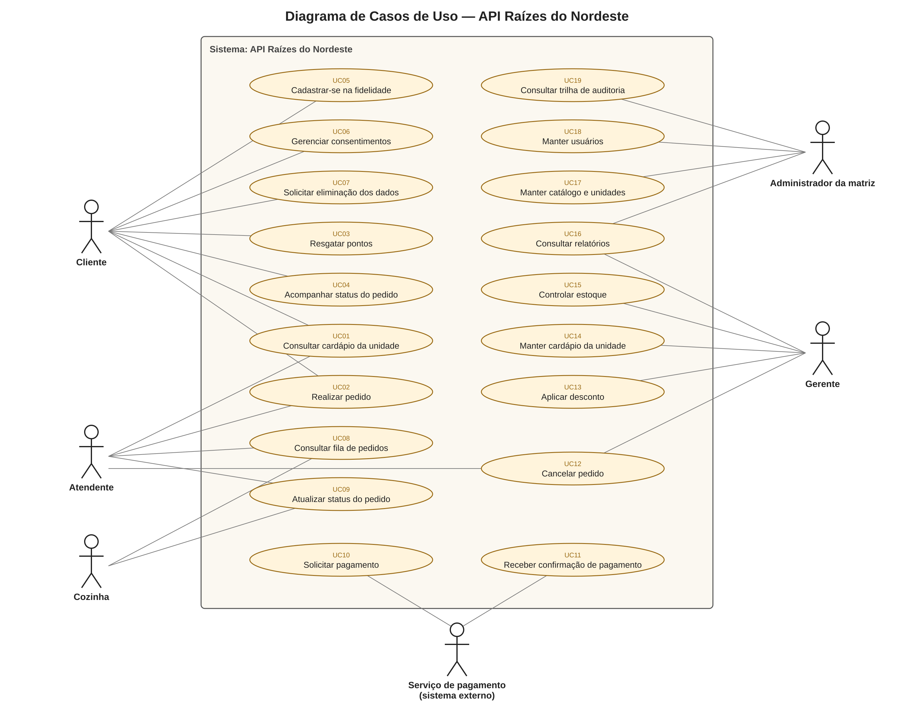
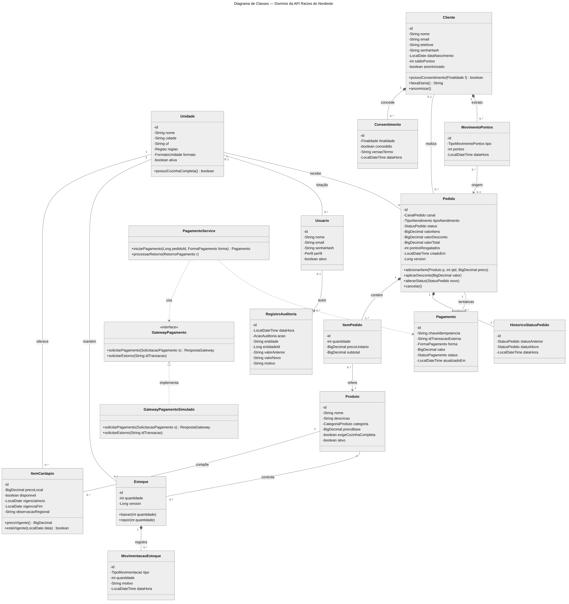
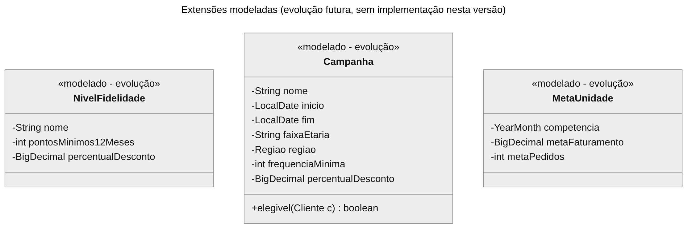
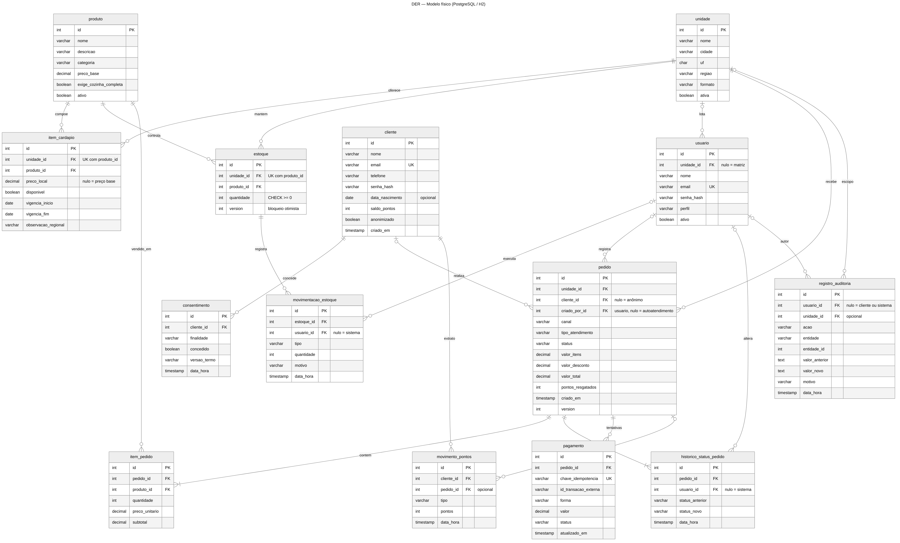

# 02 — Modelagem

**Projeto:** API Back-end da Rede "Raízes do Nordeste"

---

## 1. Diagrama de casos de uso

| Caso de uso | Atores | Requisitos |
|---|---|---|
| UC01 Consultar cardápio da unidade | Cliente, Atendente | RF06 |
| UC02 Realizar pedido | Cliente, Atendente | RF08 |
| UC03 Resgatar pontos | Cliente | RF16 |
| UC04 Acompanhar status do pedido | Cliente | RF09 |
| UC05 Cadastrar-se na fidelidade | Cliente | RF02, RF15 |
| UC06 Gerenciar consentimentos | Cliente | RF19 |
| UC07 Solicitar eliminação dos dados | Cliente | RF19 |
| UC08 Consultar fila de pedidos | Cozinha, Atendente | RF10 |
| UC09 Atualizar status do pedido | Cozinha, Atendente | RF10 |
| UC10 Solicitar pagamento | Serviço de pagamento | RF11 |
| UC11 Receber confirmação de pagamento | Serviço de pagamento | RF12 |
| UC12 Cancelar pedido | Atendente (não pago), Gerente | RF13 |
| UC13 Aplicar desconto | Gerente | RF14 |
| UC14 Manter cardápio da unidade | Gerente | RF05 |
| UC15 Controlar estoque | Gerente | RF07 |
| UC16 Consultar relatórios | Gerente (sua unidade), Matriz (todas) | RF22, RF23 |
| UC17 Manter catálogo e unidades | Administrador da matriz | RF03, RF04 |
| UC18 Manter usuários | Administrador da matriz | RF25 |
| UC19 Consultar trilha de auditoria | Administrador da matriz | RF21 |

**Observações**
- A autenticação (RF01) é pré-condição de todos os casos de uso, exceto UC01, e foi omitida do diagrama para não poluir a leitura.
- O registro de auditoria (RF20) é executado automaticamente pelo sistema dentro de UC06, UC07, UC12, UC13, UC14 e UC15; não é um caso de uso disparado por ator.
- Ao realizar um pedido (UC02), o sistema sempre solicita o pagamento ao serviço externo (UC10), pois todos os pagamentos passam por ele (RN17). O resgate de pontos (UC03) é opcional e acontece durante a realização do pedido.

## 2. Diagrama de classes

**Decisões de modelagem**
- **Catálogo global × cardápio da unidade.** `Produto` pertence à matriz (padronização da franquia); `ItemCardapio` liga um produto a uma unidade com preço local, vigência sazonal e observação de variação regional (RN01, RN02, RNF11).
- **Estoque com versão.** `Estoque.version` implementa o controle de concorrência otimista: se dois pedidos tentarem baixar o último item ao mesmo tempo, apenas um é gravado e o outro recebe erro de conflito (RN03, RNF04).
- **Preço congelado no item.** `ItemPedido.precoUnitario` guarda o preço do momento da compra; mudanças futuras de preço não alteram pedidos antigos (RN02).
- **Histórico em vez de sobrescrita.** `HistoricoStatusPedido`, `MovimentacaoEstoque`, `MovimentoPontos`, `Consentimento` e `RegistroAuditoria` guardam o histórico completo, sem apagar o estado anterior. Isso atende à rastreabilidade exigida pela matriz e à prova de consentimento exigida pela LGPD.
- **Pagamento desacoplado.** O domínio depende da interface `GatewayPagamento`, não de um fornecedor. Nesta versão a implementação é `GatewayPagamentoSimulado`; trocar por um provedor real exige apenas uma nova implementação da interface (princípio da inversão de dependência).
- **Várias tentativas de pagamento.** Um `Pedido` pode ter vários `Pagamento` (ex.: cartão recusado e depois Pix aprovado). `chaveIdempotencia` impede o processamento duplicado da mesma tentativa (RN14).
- **Cliente anônimo.** `Pedido` → `Cliente` tem multiplicidade 0..1, permitindo pedidos sem identificação no totem e no balcão (RN13).

### Enumerações do domínio

| Enumeração | Valores |
|---|---|
| StatusPedido | AGUARDANDO_PAGAMENTO, PAGO, EM_PREPARO, PRONTO, ENTREGUE, CANCELADO |
| CanalPedido | APP, TOTEM, BALCAO |
| TipoAtendimento | CONSUMO_LOCAL, RETIRADA |
| Perfil | ATENDENTE, COZINHA, GERENTE, ADMIN_MATRIZ |
| Finalidade | FIDELIDADE, MARKETING |
| StatusPagamento | PENDENTE, APROVADO, RECUSADO, ERRO, ESTORNO_SOLICITADO |
| FormaPagamento | PIX, CARTAO_CREDITO, CARTAO_DEBITO |
| FormatoUnidade | COMPLETA, REDUZIDA |
| Regiao | NORTE, NORDESTE, CENTRO_OESTE, SUDESTE, SUL |
| CategoriaProduto | TAPIOCA, CUSCUZ, BOLO, SALGADO, BEBIDA, CAFE_DA_MANHA |
| TipoMovimentacao | ENTRADA, AJUSTE, SAIDA_PEDIDO, DEVOLUCAO_PEDIDO |
| TipoMovimentoPontos | CREDITO, RESGATE, ESTORNO |
| AcaoAuditoria | CANCELAMENTO_PEDIDO, DESCONTO_PEDIDO, AJUSTE_ESTOQUE, ALTERACAO_PRECO, ACESSO_DADOS_PESSOAIS, REVOGACAO_CONSENTIMENTO, ANONIMIZACAO_CLIENTE |

### Extensões modeladas (sem implementação nesta versão)

- `NivelFidelidade` — descontos progressivos por pontos acumulados em 12 meses (RF17).
- `Campanha` — campanhas segmentadas por faixa etária, região e frequência, aplicáveis apenas a clientes com consentimento de marketing (RF18, RN10).
- `MetaUnidade` — metas mensais de faturamento e pedidos por unidade (RF24).

## 3. DER — Diagrama Entidade-Relacionamento

**Restrições de integridade**

| Tabela | Restrição | Motivo |
|---|---|---|
| item_cardapio | UNIQUE (unidade_id, produto_id) | Um produto aparece uma única vez no cardápio de cada unidade |
| estoque | UNIQUE (unidade_id, produto_id); CHECK (quantidade >= 0) | Um saldo por produto por unidade; estoque nunca negativo |
| pagamento | UNIQUE (chave_idempotencia) | Impede processar duas vezes a mesma solicitação |
| usuario, cliente | UNIQUE (email) | Login único |
| pedido, estoque | Coluna `version` | Controle de concorrência otimista |

**Índices previstos** (consultas mais frequentes)
- `pedido (unidade_id, status)` — fila da cozinha e acompanhamento.
- `pedido (unidade_id, criado_em)` — relatórios de vendas por período.
- `registro_auditoria (data_hora, acao)` — consulta da trilha de auditoria.

**Persistência**
- **PostgreSQL** é o banco-alvo de produção: relacional, transacional (ACID), maduro e de código aberto. As transações garantem que pedido, itens e baixa de estoque sejam gravados juntos ou não sejam gravados.
- **H2** (em memória) é usado na demonstração e nos testes automatizados, sem necessidade de instalação. O acesso é feito por JPA/Hibernate, que abstrai o banco; a troca para PostgreSQL é feita por configuração.
- Valores monetários usam `DECIMAL` (e `BigDecimal` no Java) para evitar erros de arredondamento de ponto flutuante.
- Enumerações são gravadas como texto (`varchar`), o que mantém os dados legíveis e evita erros se a ordem dos valores mudar.
