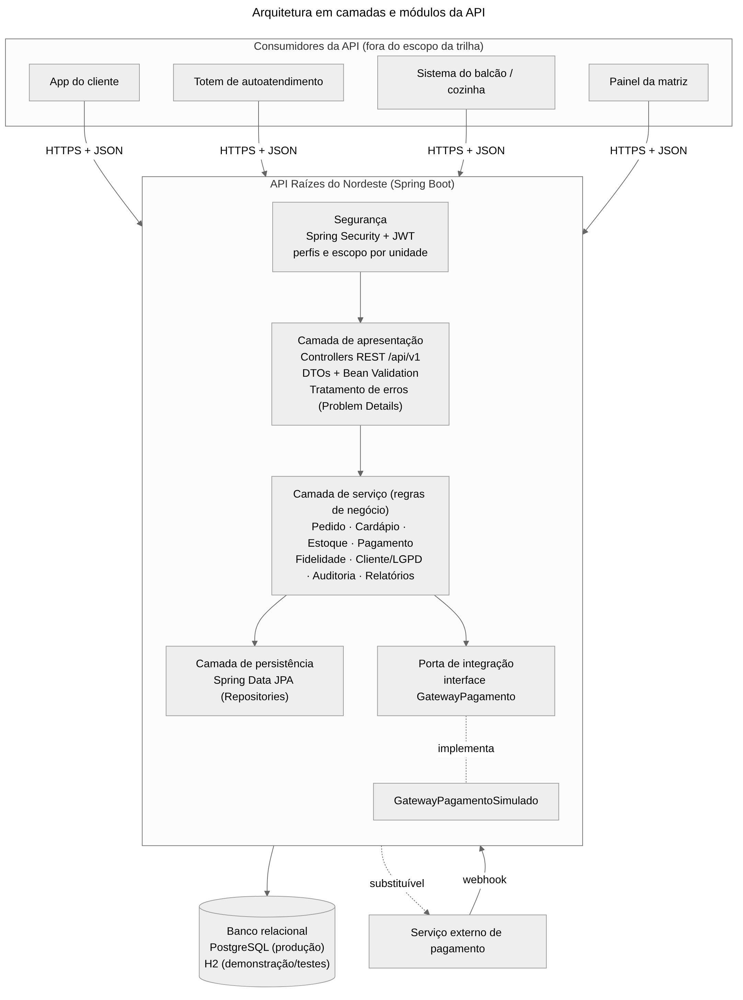
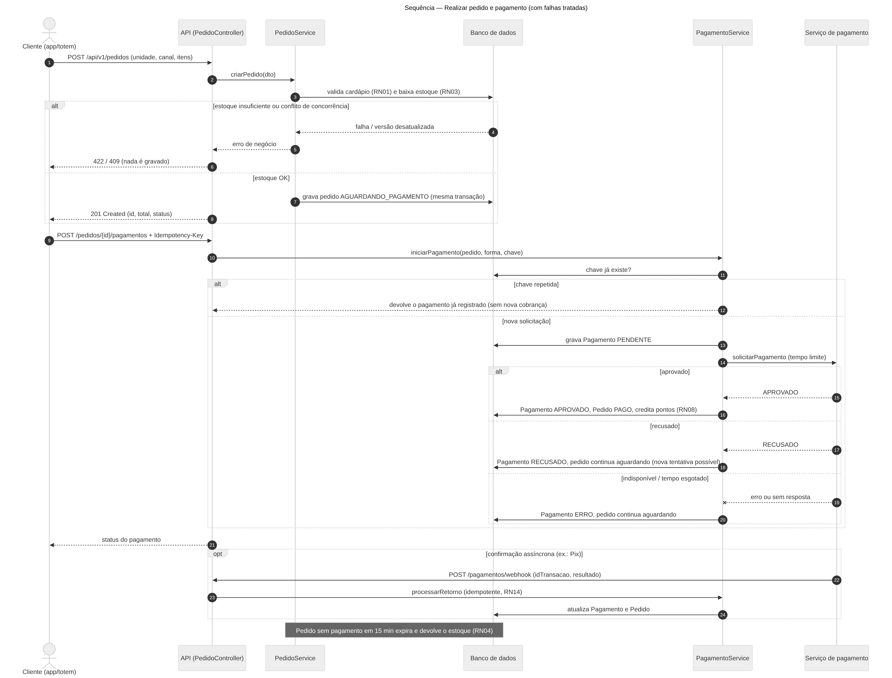
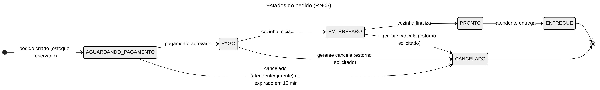
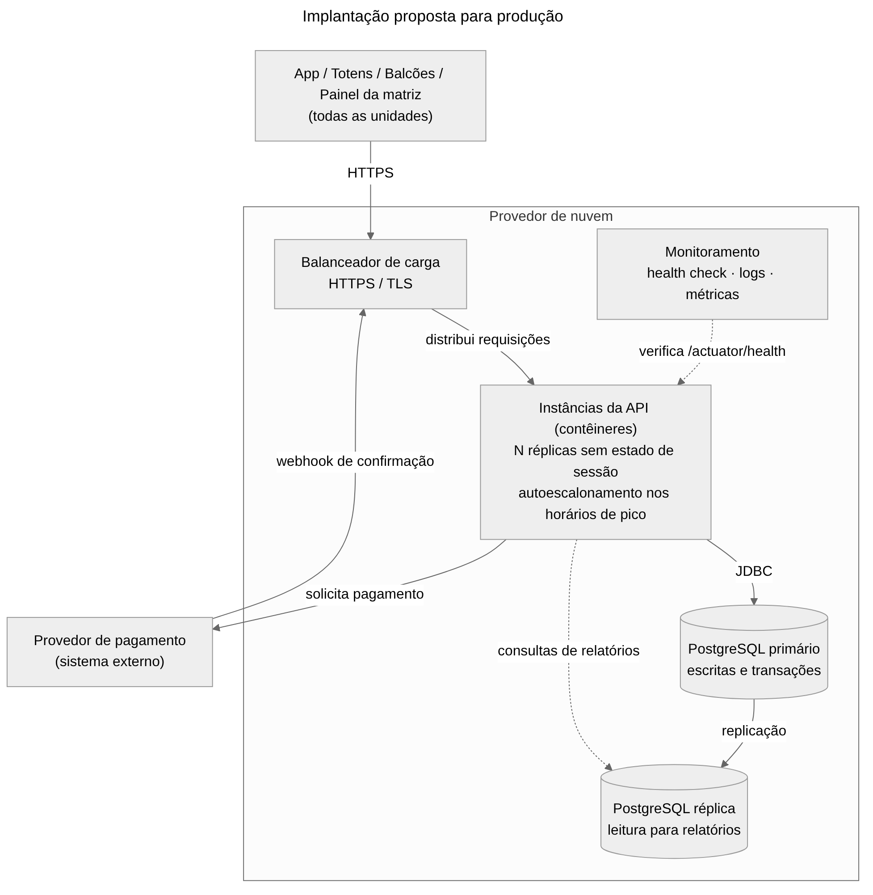

# 03 — Arquitetura e API

**Projeto:** API Back-end da Rede "Raízes do Nordeste"

---

## 1. Estilo arquitetural

A solução é um **monólito modular em camadas**: uma única aplicação Spring Boot, organizada por módulos de negócio (pedido, cardápio, estoque, pagamento, fidelidade, cliente/LGPD, auditoria, relatórios), em que cada módulo segue as camadas controller → service → repository.



**Por que não microsserviços desde o início**

| Critério | Monólito modular (escolhido) | Microsserviços |
|---|---|---|
| Consistência | Pedido, itens e baixa de estoque na mesma transação do banco | Exigiria transações distribuídas (sagas) entre serviços |
| Complexidade operacional | Uma aplicação, um banco | Vários serviços, rede, descoberta de serviços, observabilidade distribuída |
| Escalabilidade | Escala horizontalmente com várias instâncias sem estado atrás de balanceador | Escala cada serviço separadamente |
| Evolução | Módulos com fronteiras claras podem ser extraídos depois (ex.: pagamento, relatórios) | Já nasce distribuído |

Para o porte atual da rede e para o prazo do projeto, o monólito modular atende escalabilidade e disponibilidade (seção 3) sem a complexidade dos microsserviços. A integração de pagamento já é isolada por interface, o que facilita uma extração futura.

**Responsabilidade de cada camada**

| Camada | Responsabilidade | Tecnologia |
|---|---|---|
| Segurança | Autenticar (JWT) e autorizar por perfil e por unidade | Spring Security |
| Apresentação | Receber requisições HTTP, validar a entrada, converter DTOs, padronizar erros | Spring Web MVC, Bean Validation |
| Serviço | Regras de negócio (RN01–RN18), transações, auditoria | Spring (`@Service`, `@Transactional`) |
| Persistência | Acesso ao banco | Spring Data JPA / Hibernate |
| Integração | Comunicação com o serviço de pagamento | Interface `GatewayPagamento` |

## 2. Fluxo principal: pedido e pagamento

O diagrama mostra o caminho feliz e as falhas tratadas: estoque insuficiente, conflito de concorrência, repetição da mesma solicitação de pagamento, recusa, indisponibilidade do serviço externo e confirmação assíncrona.



**Estados do pedido** (RN05): qualquer transição fora deste diagrama é rejeitada pela API com erro 409.



## 3. Escalabilidade, disponibilidade e tolerância a falhas



| Preocupação do caso | Como a arquitetura responde |
|---|---|
| Picos de movimento | API **sem estado de sessão** (token JWT): qualquer instância atende qualquer requisição, e novas instâncias podem ser adicionadas automaticamente nos horários de pico |
| Sistema não pode falhar | Várias instâncias atrás do balanceador; uma instância com problema é retirada pelo health check (`/actuator/health`) sem derrubar o serviço |
| Falha no serviço de pagamento | Tempo limite na chamada; o pagamento fica como ERRO e o pedido continua aguardando, permitindo nova tentativa; a API continua atendendo os demais pedidos |
| Cobrança duplicada | Chave de idempotência (`Idempotency-Key`) única por solicitação; webhook processado de forma idempotente |
| Venda acima do estoque | Transação única + bloqueio otimista (`version`) |
| Relatórios pesados competindo com vendas | Em produção, relatórios leem de uma réplica do banco |
| Crescimento da rede | Novas unidades, regiões e produtos entram por cadastro, sem mudança de código |

**Implementado nesta versão × proposto para produção:** a API, as transações, o bloqueio otimista, a idempotência, o tempo limite e o health check estão implementados. Balanceador, réplicas, autoescalonamento e monitoramento são a proposta de implantação e não foram provisionados.

## 4. Segurança e LGPD na API

- **Autenticação:** login devolve um token JWT assinado, com validade de 2 horas, contendo o perfil e a unidade do usuário.
- **Autorização:** cada endpoint declara os perfis permitidos; além disso, gerente, atendente e cozinha só acessam dados da própria unidade (RN15).
- **Senhas:** armazenadas com hash BCrypt, nunca em texto.
- **Dados pessoais:** respostas da API para perfis internos não expõem e-mail nem telefone de clientes; o acesso a dados pessoais é auditado; dados pessoais não são escritos em log.
- **Webhook do pagamento:** aceito apenas com o segredo compartilhado no cabeçalho `X-Gateway-Token`.
- **Transporte:** em produção, somente HTTPS (terminado no balanceador).

## 5. Convenções da API

- Base: `/api/v1` (versão no caminho, permitindo evoluir sem quebrar os consumidores).
- Formato: JSON; datas no padrão ISO-8601; valores monetários com duas casas decimais.
- Documentação interativa: Swagger UI em `/swagger-ui.html` (OpenAPI).
- Erros no formato padrão **Problem Details** (RFC 9457):

```json
{
  "type": "about:blank",
  "title": "Estoque insuficiente",
  "status": 422,
  "detail": "Produto 'Tapioca de carne de sol' possui 2 unidades em estoque; solicitado: 3.",
  "instance": "/api/v1/pedidos"
}
```

| Código | Quando |
|---|---|
| 200 / 201 / 204 | Sucesso (consulta / criação / sem conteúdo) |
| 400 | Dados de entrada inválidos (validação) |
| 401 | Sem token ou token inválido |
| 403 | Perfil sem permissão ou unidade diferente da do usuário |
| 404 | Recurso inexistente |
| 409 | Conflito: transição de status inválida, conflito de concorrência, e-mail já cadastrado |
| 422 | Regra de negócio violada: estoque insuficiente, produto indisponível, desconto acima do limite, pontos insuficientes |
| 503 | Serviço de pagamento indisponível (o pedido é preservado) |

## 6. Principais endpoints

Perfis: **PÚB** = público (sem login), **CLI** = cliente, **ATD** = atendente, **COZ** = cozinha, **GER** = gerente, **ADM** = administrador da matriz.

### Autenticação

| Método | Caminho | Acesso | Descrição | Req. |
|---|---|---|---|---|
| POST | `/auth/login` | PÚB | Login de usuário interno; devolve token | RF01 |
| POST | `/auth/clientes/login` | PÚB | Login de cliente; devolve token | RF01 |

### Clientes e LGPD

| Método | Caminho | Acesso | Descrição | Req. |
|---|---|---|---|---|
| POST | `/clientes` | PÚB | Cadastro com declaração de maioridade e consentimentos por finalidade | RF02 |
| GET | `/clientes/me` | CLI | Dados do próprio cliente (direito de acesso) | RF19 |
| GET | `/clientes/me/consentimentos` | CLI | Situação atual e histórico de consentimentos | RF19 |
| PUT | `/clientes/me/consentimentos/{finalidade}` | CLI | Concede ou revoga uma finalidade | RF19 |
| DELETE | `/clientes/me` | CLI | Elimina (anonimiza) os dados pessoais | RF19 |
| GET | `/clientes/me/pontos` | CLI | Saldo e extrato de pontos | RF15 |

### Unidades, catálogo e cardápio

| Método | Caminho | Acesso | Descrição | Req. |
|---|---|---|---|---|
| GET | `/unidades` | PÚB | Lista unidades ativas | RF03 |
| POST / PUT | `/unidades`, `/unidades/{id}` | ADM | Cria / altera unidade | RF03 |
| GET | `/produtos` | ADM, GER | Lista o catálogo global | RF04 |
| POST / PUT | `/produtos`, `/produtos/{id}` | ADM | Cria / altera produto | RF04 |
| GET | `/unidades/{id}/cardapio` | PÚB | Cardápio da unidade, apenas itens disponíveis (RN01) | RF06 |
| PUT | `/unidades/{id}/cardapio/{produtoId}` | GER | Disponibiliza produto, preço local e vigência (preço auditado) | RF05 |

### Estoque

| Método | Caminho | Acesso | Descrição | Req. |
|---|---|---|---|---|
| GET | `/unidades/{id}/estoque` | GER | Saldo por produto | RF07 |
| POST | `/unidades/{id}/estoque/{produtoId}/entradas` | GER | Registra entrada | RF07 |
| POST | `/unidades/{id}/estoque/{produtoId}/ajustes` | GER | Ajuste manual com motivo (auditado) | RF07, RF20 |

### Pedidos

| Método | Caminho | Acesso | Descrição | Req. |
|---|---|---|---|---|
| POST | `/pedidos` | PÚB, CLI, ATD | Cria pedido (unidade, canal, tipo de atendimento, itens, pontos a resgatar) | RF08, RF16 |
| GET | `/pedidos/{id}` | CLI (dono), ATD, COZ, GER | Detalhe e status do pedido | RF09 |
| GET | `/pedidos/acompanhamento/{codigo}` | PÚB | Status por código de acompanhamento (pedidos anônimos do totem) | RF09 |
| GET | `/unidades/{id}/pedidos?status=` | ATD, COZ, GER | Fila de pedidos da unidade | RF10 |
| PATCH | `/pedidos/{id}/status` | ATD, COZ | Avança o status conforme o ciclo válido | RF10 |
| POST | `/pedidos/{id}/cancelamento` | ATD (não pago), GER | Cancela com motivo; devolve estoque; estorno se pago (auditado) | RF13 |
| POST | `/pedidos/{id}/desconto` | GER | Desconto manual com motivo, até 20% (auditado) | RF14 |

### Pagamentos

| Método | Caminho | Acesso | Descrição | Req. |
|---|---|---|---|---|
| POST | `/pedidos/{id}/pagamentos` | PÚB, CLI, ATD | Solicita pagamento; exige cabeçalho `Idempotency-Key` | RF11 |
| GET | `/pedidos/{id}/pagamentos` | CLI (dono), ATD, GER | Tentativas de pagamento do pedido | RF11 |
| POST | `/pagamentos/webhook` | Serviço externo (`X-Gateway-Token`) | Confirmação assíncrona, idempotente | RF12 |

### Relatórios e auditoria

| Método | Caminho | Acesso | Descrição | Req. |
|---|---|---|---|---|
| GET | `/relatorios/vendas?inicio&fim&agrupamento=UNIDADE\|REGIAO` | ADM, GER (só sua unidade) | Vendas pagas no período | RF22 |
| GET | `/relatorios/produtos-mais-vendidos?inicio&fim&unidadeId&limite` | ADM, GER (só sua unidade) | Ranking de produtos | RF23 |
| GET | `/auditoria?inicio&fim&acao&unidadeId` | ADM | Trilha de auditoria | RF21 |

### Operação

| Método | Caminho | Acesso | Descrição | Req. |
|---|---|---|---|---|
| GET | `/actuator/health` | PÚB | Verificação de saúde para o balanceador | RNF07 |
| GET | `/swagger-ui.html` | PÚB | Documentação interativa | RNF10 |

## 7. Serviço de pagamento simulado

Para demonstrar e testar a integração sem um provedor real, `GatewayPagamentoSimulado` implementa a mesma interface que um provedor real implementaria. O resultado é determinado pelo valor de centavos do pedido, o que torna os testes reproduzíveis:

| Centavos do valor | Resultado simulado |
|---|---|
| ,00 a ,96 | Aprovado (cartão) ou pendente com confirmação via webhook (Pix) |
| ,97 | Recusado |
| ,98 | Erro do serviço (indisponível) |
| ,99 | Demora acima do tempo limite |

Em produção, basta registrar outra implementação de `GatewayPagamento` (ex.: adaptador para o provedor contratado), sem alterar as regras de negócio.
